<div align="center">

# Sabeeli · سبيلي

**A free, offline-first companion for the daily life of a Muslim.**

Prayer times · Qibla · The Holy Quran with tafsir · Azkar · Tasbih · Hijri calendar

No ads. No account. No tracking. Your location never leaves your device.

</div>

<p align="center">
  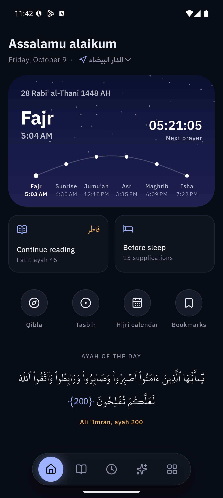
  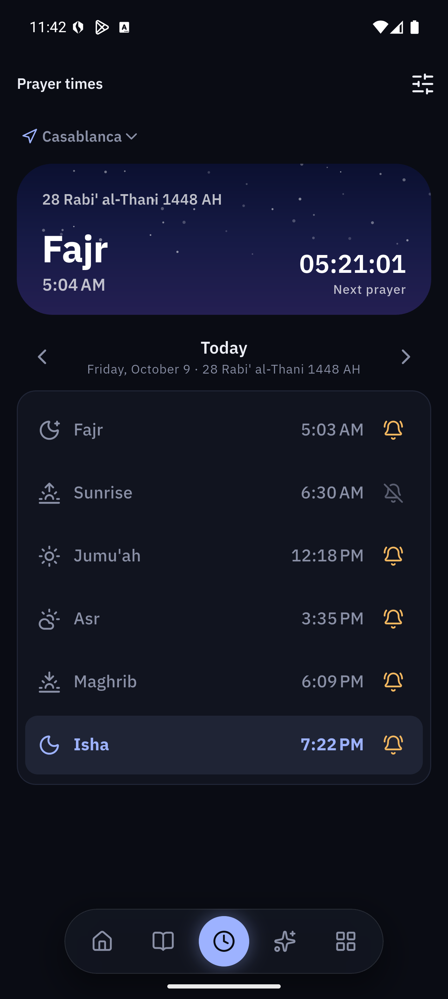
  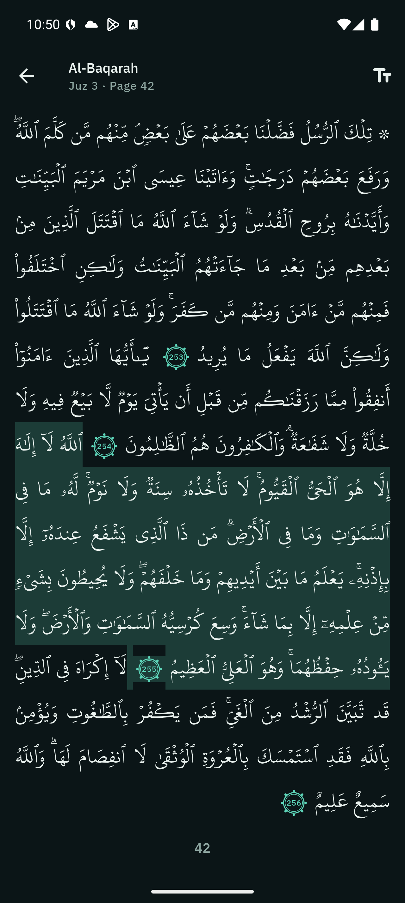
  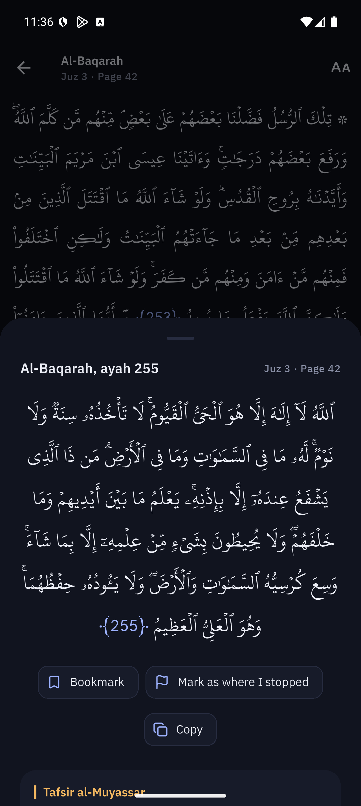
</p>
<p align="center">
  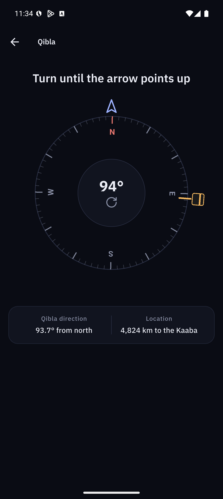
  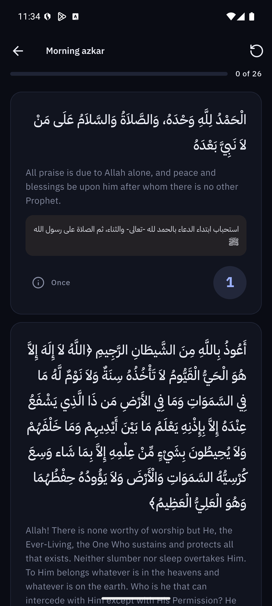
  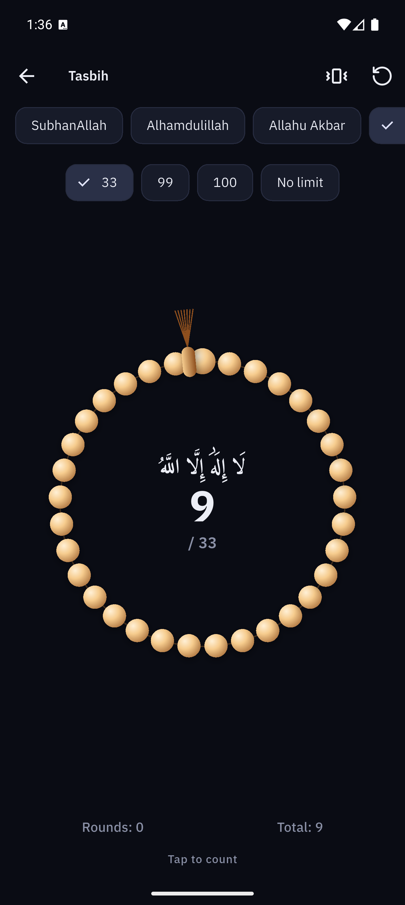
  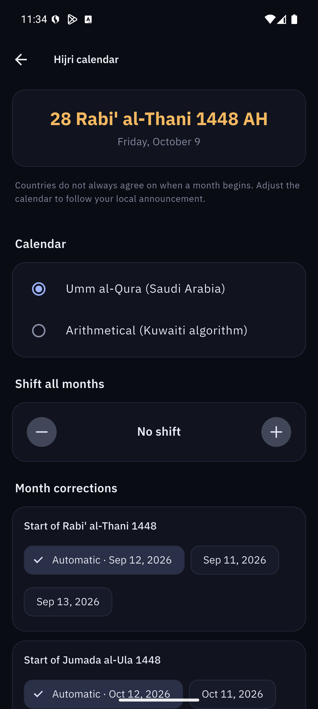
</p>
<p align="center">
  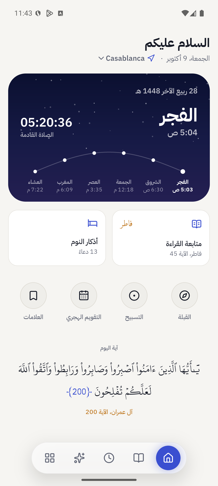
  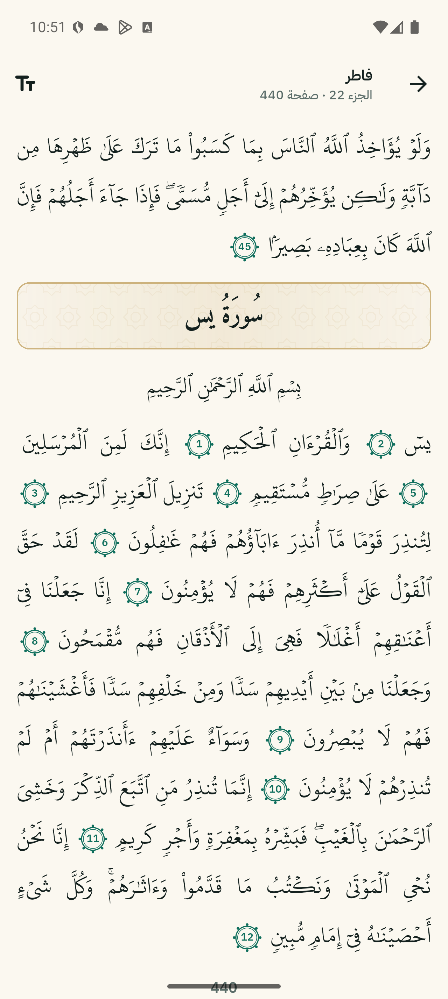
  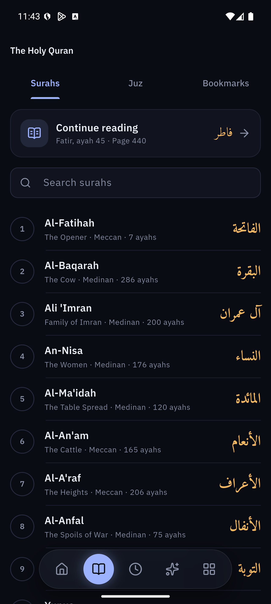
  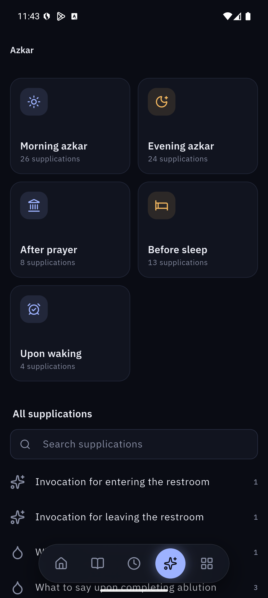
</p>

## Features

- **Prayer times:**
  - Calculated on the device for any location, with 19 calculation methods. The method is chosen automatically from your country and can be changed.
  - Choice of Asr method, a high-latitude rule, and per-prayer minute adjustments to match your mosque.
- **Prayer notifications:** use the phone's own notification sound, or are silent or off, per prayer. An optional reminder can come before each prayer. Notifications are scheduled as exact alarms, so there is no background service.
- **Qibla:** a compass with the great-circle bearing to the Kaaba, the distance to it, and a vibration when you face it.
- **The Holy Quran:**
  - The 604-page Madani mushaf, using the King Fahd Complex Uthmanic Hafs text and font, unaltered.
  - Tap any ayah for Tafsir al-Muyassar and a translation. About thirty languages can be downloaded on demand.
  - Bookmarks, the reading position saved automatically, and adjustable font size.
- **Azkar:** the full Hisn al-Muslim with repeat counts and a tap-to-count reader. The morning or evening azkar are suggested at the right time.
- **Tasbih:** common phrases, targets of 33, 99, 100 or no limit, vibration, and totals that are kept.
- **Hijri calendar that follows your country:**
  - Umm al-Qura or the arithmetical calendar.
  - Shift every month by up to ±2 days, or pin the start of a month to your local moon-sighting announcement.
- **Your digits:**
  - Western (123), Arabic (١٢٣) or Persian (۱۲۳), chosen automatically from your region, so Morocco gets Western digits and Egypt Arabic ones.
  - The choice applies everywhere, ayah numbers in the mushaf included.
- **Languages:** العربية, English, Français, اردو, Bahasa Indonesia, Türkçe, with full right-to-left support.
- **Design:**
  - The home screen takes the colour of the sky for the current prayer period, with the day's prayers along a sun path.
  - A compact floating glass navigation capsule with a sliding active indicator.
  - Dark by default with a light mode, and a layout that adapts to phones, tablets and desktop.

## Building

The Flutter app lives in [`sabeeli/`](sabeeli/).

```sh
cd sabeeli
flutter pub get
flutter run
```

Development commands:

```sh
dart run build_runner build --delete-conflicting-outputs   # regenerate dependency injection
flutter gen-l10n                                           # regenerate translations
flutter analyze
flutter test
```

Android is the main tested platform. The code builds for iOS, macOS, Windows, Linux and web.

## Architecture

The app uses clean architecture per feature, with these layers:
- `data`: data sources and repositories;
- `domain`: entities and use cases;
- `presentation`: cubits and pages.

It also uses BLoC, `get_it` + `injectable`, and `go_router` with deep links (`sabeeli://quran/2?ayah=255`).

Everything that can reasonably be written in-house is, so the app depends on very few packages. This includes:
- the prayer-time astronomy;
- the Qibla bearing;
- the Hijri calendars;
- the compass (a small native channel on Android and iOS).

See [`sabeeli/tools/ARCHITECTURE_BLUEPRINT.md`](sabeeli/tools/ARCHITECTURE_BLUEPRINT.md) for the full design.

## Data sources

All religious texts are bundled verbatim from authoritative sources:
- **King Fahd Glorious Quran Printing Complex:** Quran text, font and Tafsir al-Muyassar.
- **Tanzil.net:** mushaf structure.
- **Hisn al-Muslim:** azkar.
- **Umm al-Qura calendar tables.**

Every file, its origin and its license are listed in [`sabeeli/assets/SOURCES.md`](sabeeli/assets/SOURCES.md). The scripts that rebuild them are in [`sabeeli/tool/data/`](sabeeli/tool/data/).

## Contributing translations

UI strings live in [`sabeeli/lib/l10n/`](sabeeli/lib/l10n/). `intl_en.arb` is the template. To add a language:
1. Copy `intl_en.arb` to `intl_<code>.arb` and translate every value.
2. Add the language to `L10n.languages` in `lib/l10n/l10n.dart`.

Corrections from native speakers are very welcome.
