<div align="center">

# Sabeeli · سبيلي

**A free, offline-first companion for the daily life of a Muslim.**

Prayer times · After-prayer adhkar · The Holy Quran in Hafs, Warsh and Qalun · Qibla · Azkar · Misbaha · Hijri calendar

No ads. No account. No tracking. Your location never leaves your device.

</div>

<p align="center">
  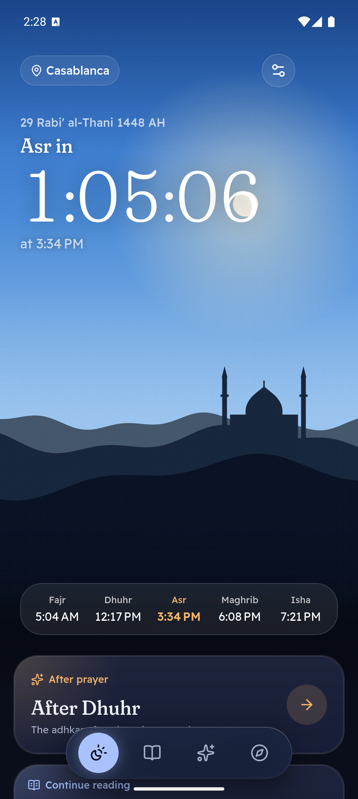
  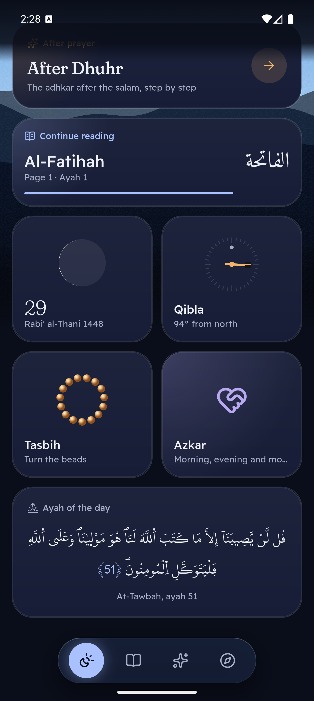
  
  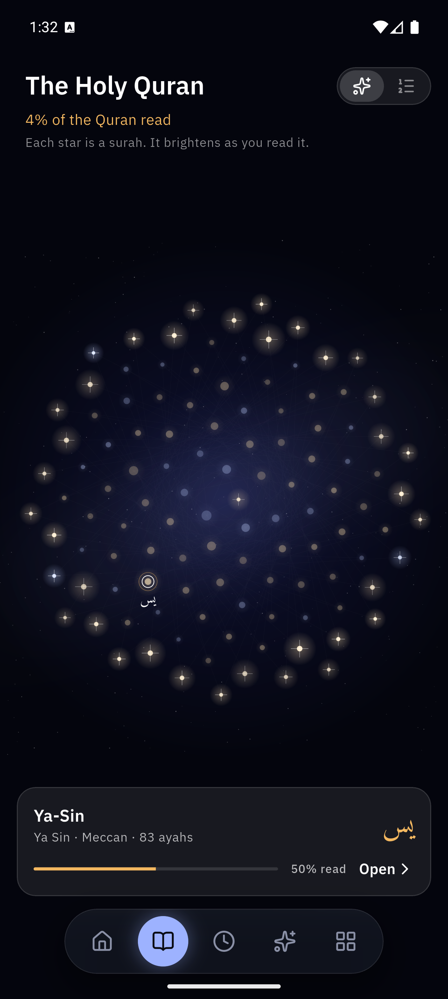
</p>

<p align="center"><em>After every prayer, the adhkar of the Sunnah step by step, counted on a misbaha. The Quran can be read in Hafs, Warsh or Qalun, each in its own King Fahd Complex mushaf.</em></p>
<p align="center">
  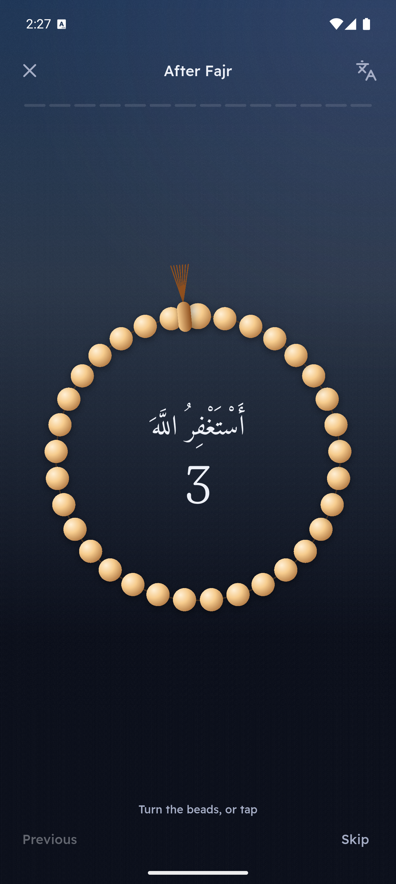
  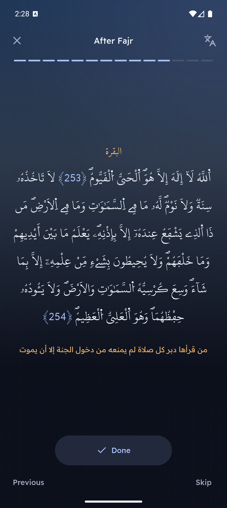
  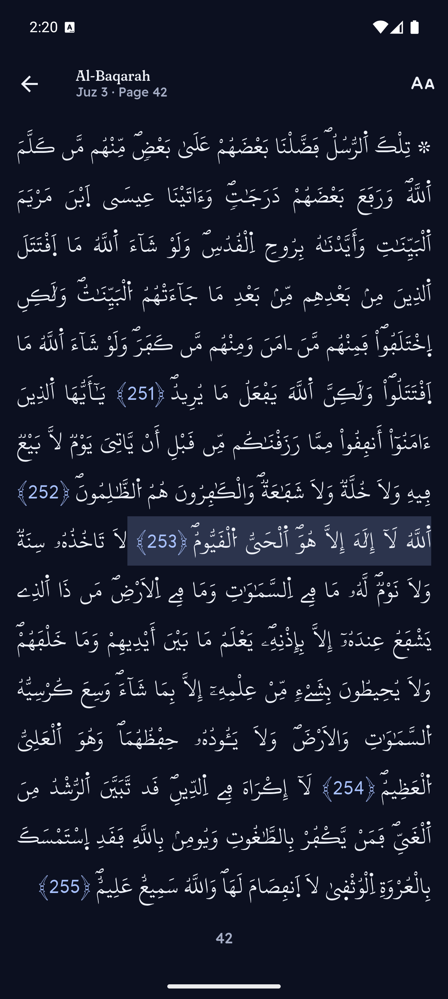
  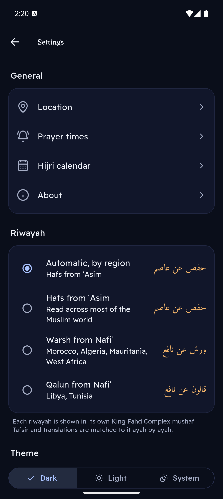
</p>
<p align="center">
  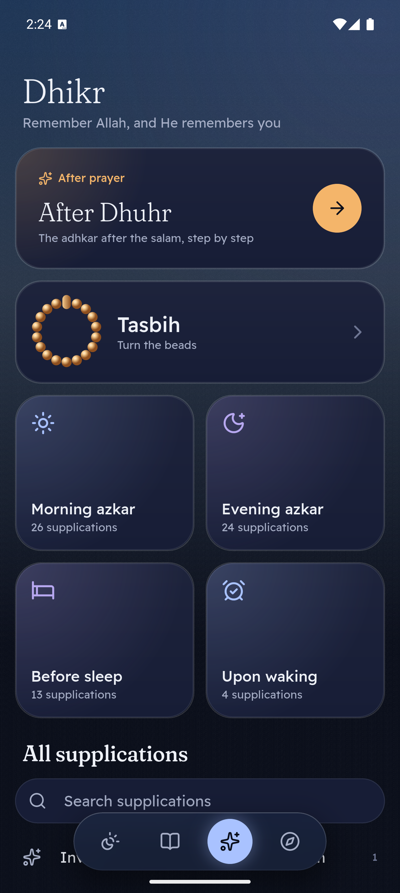
  
  
  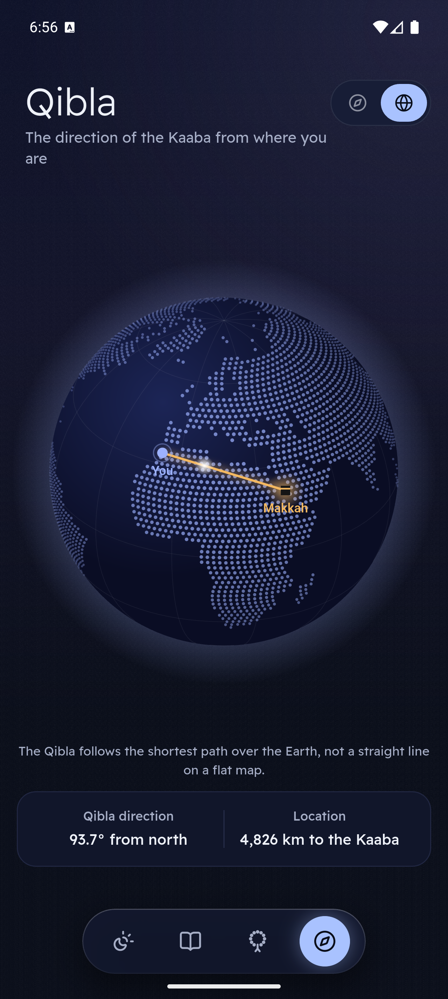
</p>
<p align="center">
  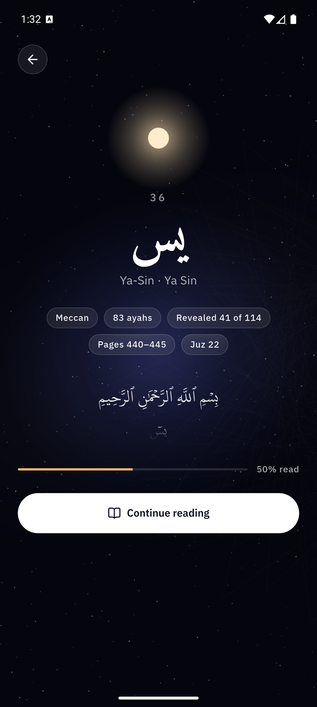
  
  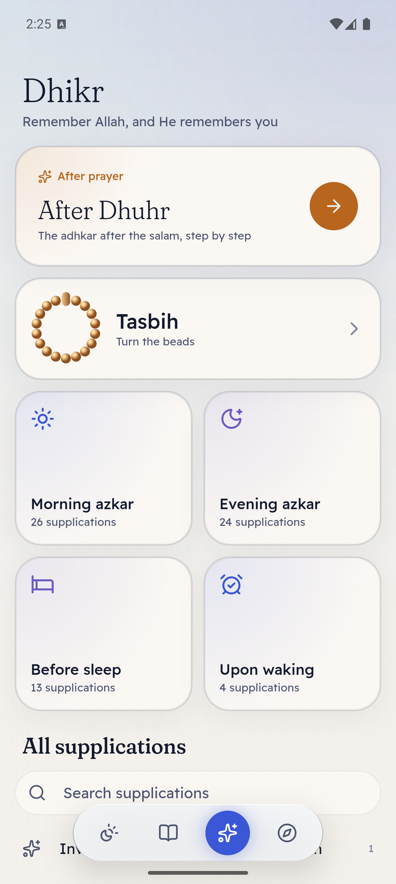
  
</p>

<p align="center"><em>The sky is the real one above you: the sun and the moon where they actually are, in the moon's real phase. Below, the same scene at other hours.</em></p>
<p align="center">
  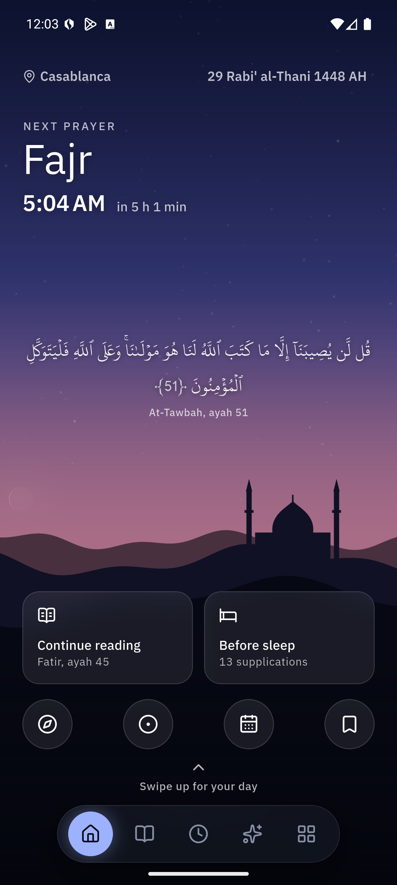
  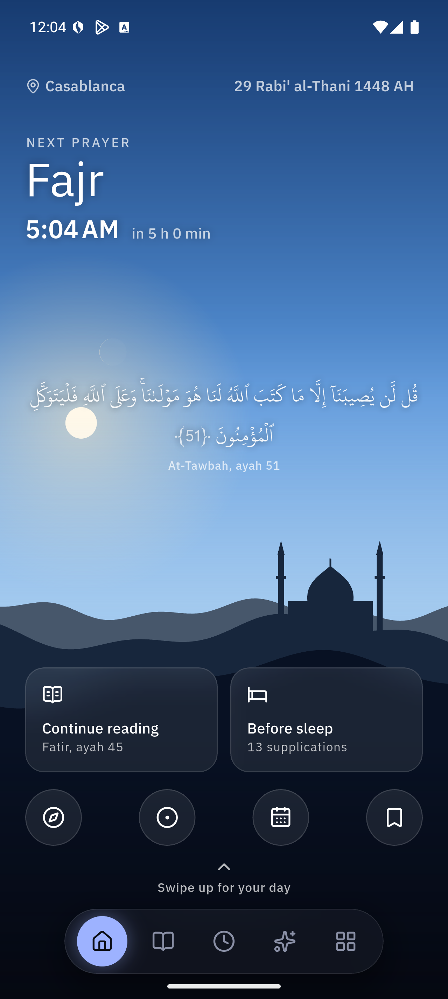
  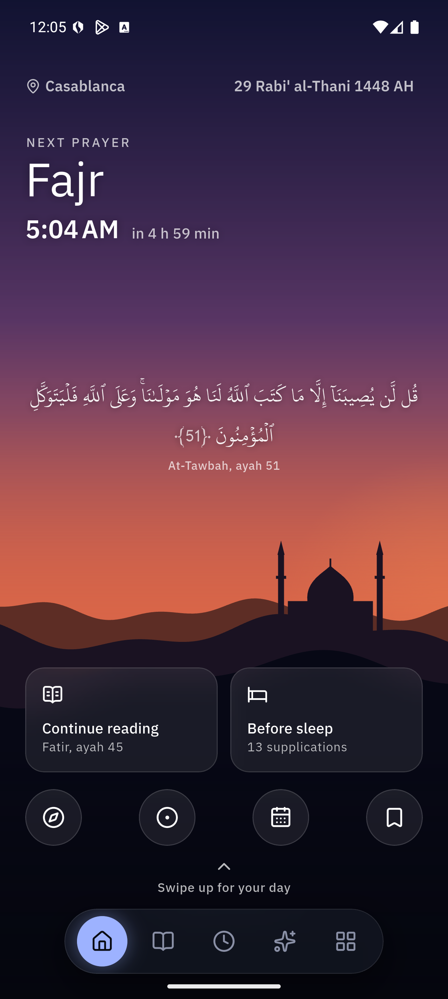
  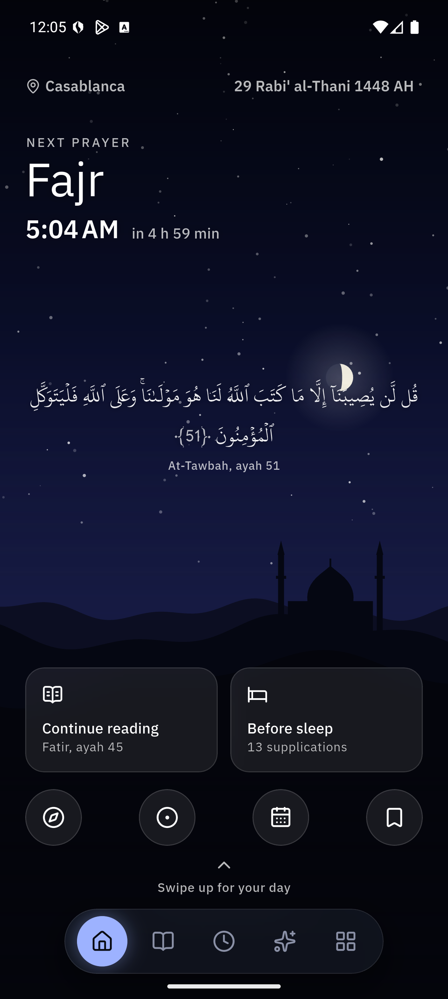
</p>

## Features

- **Prayer times:**
  - Calculated on the device for any location, with 19 calculation methods. The method is chosen automatically from your country and can be changed.
  - Choice of Asr method, a high-latitude rule, and per-prayer minute adjustments to match your mosque.
- **Prayer notifications:** use the phone's own notification sound, or are silent or off, per prayer. An optional reminder can come before each prayer. Notifications are scheduled as exact alarms, so there is no background service.
- **Adhkar after prayer:** after each prayer, the adhkar of the Sunnah one step at a time, in the order of Hisn al-Muslim: istighfar, the tasbih, tahmid and takbir counted 33 times each on the misbaha, Ayat al-Kursi and the three Quls from the mushaf. After Fajr and Maghrib the session adds what is said only then. Today offers it right after each prayer time.
- **Qibla:** a compass with the great-circle bearing to the Kaaba, the distance to it, and a vibration when you face it; or a globe showing the path itself.
- **The Holy Quran:**
  - The 604-page Madani mushaf from the King Fahd Complex, text and font unaltered, in three riwayat: **Hafs** from ʿAsim, **Warsh** from Nafiʿ (the Maghreb and West Africa) and **Qalun** from Nafiʿ (Libya, Tunisia). The riwayah follows your region until you choose one.
  - Each riwayah keeps its own numbering (Warsh counts 6214 ayahs). Tafsir, translations, bookmarks and links are matched to it ayah by ayah.
  - Tap any ayah for Tafsir al-Muyassar and a translation. About thirty languages can be downloaded on demand.
  - Bookmarks, the reading position saved automatically, and adjustable font size.
- **Azkar:** the full Hisn al-Muslim with repeat counts and a tap-to-count reader. The morning or evening azkar are suggested at the right time.
- **Misbaha:** 33 beads you turn with your thumb, with haptic clicks; common phrases, targets of 33, 99, 100 or no limit, and totals that are kept.
- **Hijri calendar that follows your country:**
  - Umm al-Qura or the arithmetical calendar.
  - Shift every month by up to ±2 days, or pin the start of a month to your local moon-sighting announcement.
- **Your digits:**
  - Western (123), Arabic (١٢٣) or Persian (۱۲۳), chosen automatically from your region, so Morocco gets Western digits and Egypt Arabic ones.
  - The choice applies everywhere, ayah numbers in the mushaf included.
- **Languages:** العربية, English, Français, اردو, Bahasa Indonesia, Türkçe, with full right-to-left support.
- **Today, under a living sky:**
  - The sky above you right now, drawn in code from real astronomy: the sun and the moon at their true positions, the moon in its real phase, stars and shooting stars at night, and dunes with a mosque on the horizon. The layers move with the tilt of the phone.
  - The next prayer written across it with a rolling countdown, and the day's five times on the horizon. Tap them to dive into **your day**: the prayers along a timeline coloured by the sky of every hour.
  - Below the horizon, live tiles: what to say now, where you stopped reading, the moon and the Hijri date, the Qibla, the misbaha and an ayah for the day.
- **The Quran as a night sky:** the 114 surahs as stars that brighten as you read them, with a magazine-style opening for every surah (calligraphy, revelation order, pages, juz, progress).
- **A moon-phase Hijri calendar:** every day in the real phase of the moon, with the white days, the Eids, Arafah, Ashura and Ramadan marked.
- **Design:** four places (Today, Quran, Dhikr, Qibla) in a floating glass capsule. Every screen takes a faint tint from the real sky, with a fine film grain; Readex Pro, Fraunces and Reem Kufi type; spring motion and haptics. Dark by default with a light mode, and layouts that adapt to phones, tablets and desktop. Animations respect the system "reduce motion" setting.

## Building

The Flutter app lives in [`sabeeli/`](sabeeli/).

```sh
cd sabeeli
flutter pub get
flutter run
```

Development commands:

```sh
dart run build_runner build --delete-conflicting-outputs   # regenerate dependency injection
flutter gen-l10n                                           # regenerate translations
flutter analyze
flutter test
```

Android is the main tested platform. The code builds for iOS, macOS, Windows, Linux and web.

## Architecture

The app uses clean architecture per feature, with these layers:
- `data`: data sources and repositories;
- `domain`: entities and use cases;
- `presentation`: cubits and pages.

It also uses BLoC, `get_it` + `injectable`, and `go_router` with deep links (`sabeeli://quran/2?ayah=255`).

Everything that can reasonably be written in-house is, so the app depends on very few packages. This includes:
- the prayer-time astronomy;
- the Qibla bearing;
- the Hijri calendars;
- the compass (a small native channel on Android and iOS);
- the mapping between the ayah numbering of the riwayat;
- the film grain (a fragment shader) and the painted scenes.

See [`sabeeli/tools/ARCHITECTURE_BLUEPRINT.md`](sabeeli/tools/ARCHITECTURE_BLUEPRINT.md) for the full design.

## Data sources

All religious texts are bundled verbatim from authoritative sources:
- **King Fahd Glorious Quran Printing Complex:** the Quran in the riwayat of Hafs, Warsh and Qalun with their fonts, and Tafsir al-Muyassar.
- **Tanzil.net:** mushaf structure.
- **Hisn al-Muslim:** azkar.
- **Umm al-Qura calendar tables.**

Every file, its origin and its license are listed in [`sabeeli/assets/SOURCES.md`](sabeeli/assets/SOURCES.md). The scripts that rebuild them are in [`sabeeli/tool/data/`](sabeeli/tool/data/).

## Contributing translations

UI strings live in [`sabeeli/lib/l10n/`](sabeeli/lib/l10n/). `intl_en.arb` is the template. To add a language:
1. Copy `intl_en.arb` to `intl_<code>.arb` and translate every value.
2. Add the language to `L10n.languages` in `lib/l10n/l10n.dart`.

Corrections from native speakers are very welcome.
